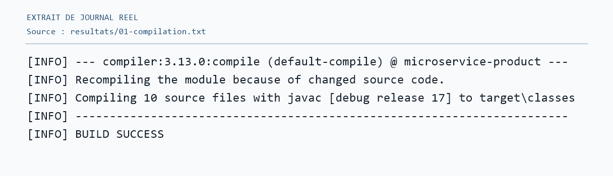
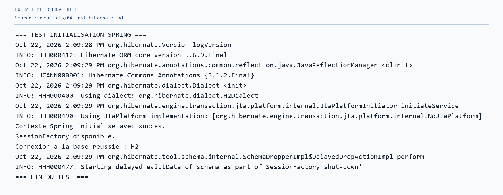
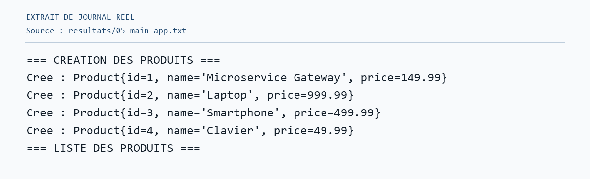
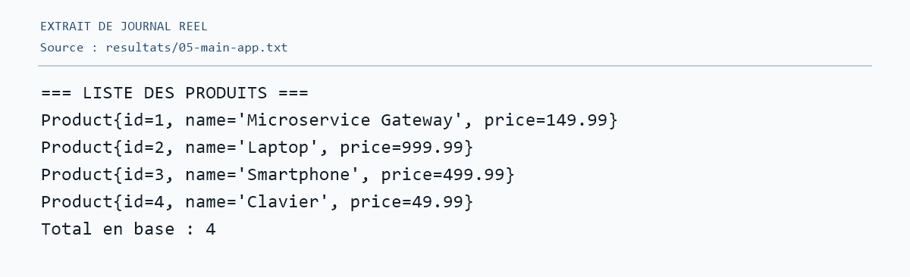
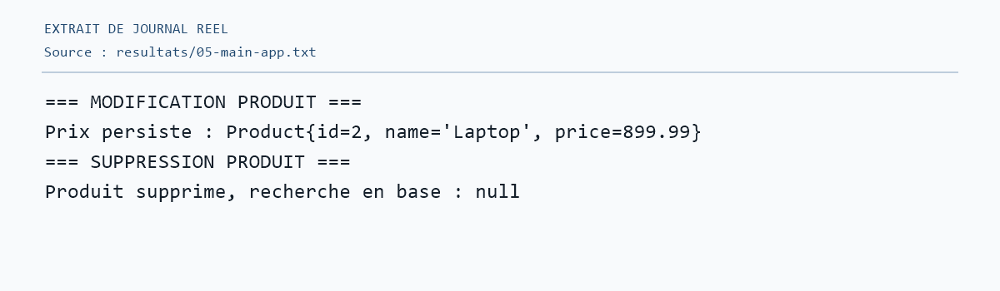
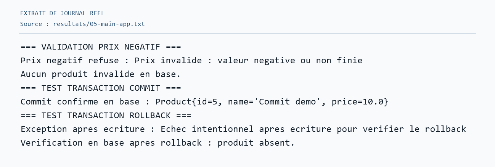
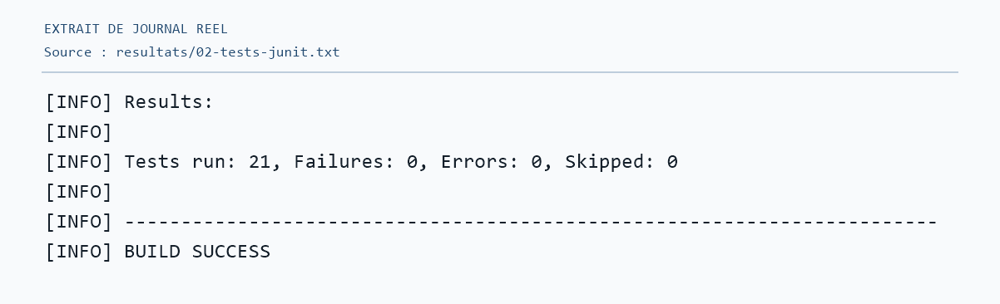
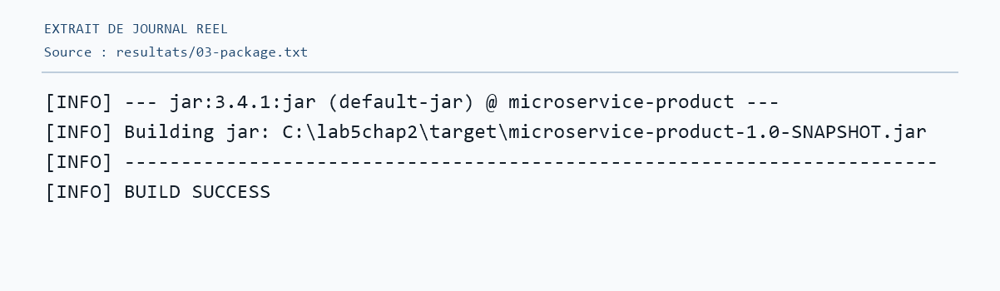

# Chapitre 2 – Lab 5 : Spring et Hibernate

## Objectif

Ce laboratoire relie Spring Framework à Hibernate pour gérer des produits dans une base relationnelle. Il illustre un DAO générique, l'injection de dépendances et les transactions.

## Technologies utilisées

Java 17, Maven, Spring Framework 5.3.20, Hibernate 5.6.9.Final, MySQL (configuration prévue), H2 (exécution vérifiée) et JUnit 4.

## Travail réalisé

L'entité `Product`, l'interface `IDao<T>`, la configuration Spring/Hibernate et l'injection du DAO dans le service permettent le CRUD. Le service valide les produits et utilise `@Transactional` pour les commits, les lectures et le rollback ; 21 tests JUnit couvrent ces opérations.

## Exécution

Utiliser le JDK 17. Les commandes suivantes exécutent la démonstration avec H2 en mémoire, sans serveur externe :

```bash
mvn clean compile
mvn clean test
mvn clean package
mvn -Dproduct.profile=h2 exec:java -Dexec.mainClass=com.microservice.product.TestHibernate
mvn -Dproduct.profile=h2 exec:java -Dexec.mainClass=com.microservice.product.MainApp
```

Sous PowerShell, entourer chaque argument `-D...` de guillemets. MySQL est l'autre configuration dans `application.properties` : créer `product_db`, démarrer le serveur et fournir le mot de passe par `PRODUCT_DB_PASSWORD`. La connexion MySQL n'a pas été validée localement (port 3306 fermé).

## Résultats

| Vérification | Résultat observé |
|---|---|
| Compilation | BUILD SUCCESS |
| Initialisation Spring et connexion | SessionFactory disponible, connexion H2 réussie |
| MainApp | CRUD, validation, commit et rollback vérifiés ; 4 produits restants |
| Tests JUnit | 21 réussis, 0 échec, 0 erreur, 0 ignoré |
| Packaging | BUILD SUCCESS ; JAR généré |

Les sorties complètes sont dans [`resultats/`](resultats/). Les images ci-dessous sont des **extraits de journaux réels**, et non des captures du terminal intégré.

## Captures d'écran

Compilation : 

Initialisation Spring et Hibernate : 

Création des produits : 

Liste des produits : 

Modification et suppression : 

Validation et transactions : 

Tests JUnit : 

Packaging : 

## Conclusion

Le laboratoire montre comment séparer la persistance et la logique métier avec Spring et Hibernate. Les tests confirment que les transactions enregistrent les opérations réussies et annulent celles qui échouent.
